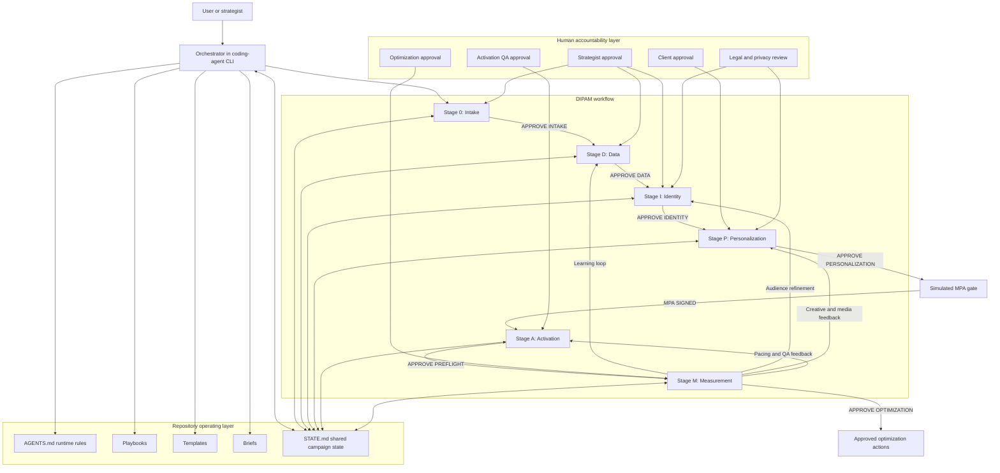

# DIPAM Agent Reference Architecture

This document describes the reference architecture for a brief-driven campaign launch agent. It is a synthetic portfolio concept using generic agency capabilities: a planning workspace, audience layer, clean room, activation workflow, and measurement layer. It does not describe or imply any real company's proprietary system.

## 1. Architecture summary

The system is an agentic workflow with human approval gates. A coding-agent CLI acts as the orchestrator. Repository playbooks define how each stage works. Campaign state files provide a shared source of truth. Templates standardize outputs. Human approvals control movement between stages.

The architecture is intentionally practical: the agent can plan, structure, reconcile, and draft; people remain accountable for strategy, claims, privacy, commercial commitments, and optimization decisions.

## 2. Reference architecture

## 3. Component responsibilities

| Component | Responsibility | Does not do |
|---|---|---|
| Orchestrator | Interprets commands, routes work through stages, enforces gates, updates state | Does not approve its own work |
| Intake stage | Extracts brief requirements, gaps, assumptions, questions, and readiness | Does not solve the campaign |
| Data stage | Builds category, consumer, competitor, price-pack, and data-readiness foundation | Does not invent market facts or audience data |
| Identity stage | Defines three actionable profiles, prioritization, signals, consent, and measurement hypotheses | Does not use sensitive or non-consented targeting |
| Personalization stage | Integrates creative, media, budget, flighting, KPIs, and test-and-learn | Does not enter Activation without MPA sign-off |
| Activation stage | Reconciles MPA, tracks IOs, tagging, trafficking, QA, dependencies, and go-live readiness | Does not execute live media buys |
| Measurement stage | Analyzes supplied performance exports and recommends optimization actions | Does not fabricate performance data |
| Shared state | Records stage, gates, approvals, decisions, assumptions, blockers, and escalations | Does not replace human judgment |
| Human approval layer | Owns strategy, client commitments, legal/privacy decisions, pre-flight QA, and optimization | Is not bypassed by the agent |

## 4. Data flow

1. A brief enters `briefs/`.
2. The orchestrator creates a campaign workspace and `STATE.md`.
3. Each stage reads approved prior outputs and writes new outputs.
4. The orchestrator updates `STATE.md` after every step.
5. A human types an exact approval phrase.
6. The next stage begins.
7. Measurement learning feeds back into Data, Identity, Personalization, and Activation.

## 5. Control model

| Control | Mechanism | Purpose |
|---|---|---|
| Stage gates | Exact approval phrases | Prevent silent or accidental progression |
| Shared state | `campaigns/<slug>/STATE.md` | Make approvals, assumptions, and decisions auditable |
| Templates | Markdown and CSV templates | Standardize outputs and reduce omissions |
| Playbooks | Stage-specific instructions | Make the workflow repeatable |
| Source log | `source-log.csv` | Separate public facts from assumptions |
| Data readiness scorecard | `data-readiness-scorecard.csv` | Prevent unsupported audience activation |
| Consent matrix | `identity-consent-matrix.csv` | Keep audience use privacy-safe |
| MPA gate | `MPA SIGNED` | Prevent unauthorized activation planning |
| QA gate | `APPROVE PREFLIGHT` | Prevent launch without operational checks |
| Optimization gate | `APPROVE OPTIMIZATION` | Keep reallocation decisions human-owned |

## 6. Privacy and compliance design

- Synthetic portfolio data only in the public repository.
- No raw PII in campaign outputs.
- Consent status documented before first-party audience activation.
- Clean-room or privacy-safe matching used conceptually where direct data sharing is inappropriate.
- Sensitive audience inferences excluded.
- Claims guardrails embedded in Intake, Personalization, and Activation.
- Legal review triggered by high-risk claims, consent uncertainty, or category-specific restrictions.

## 7. Scalability path

### Pilot

Run one or two synthetic or sanitized brand launches through the full DIPAM workflow. Measure time saved, output quality, approval friction, and rework reduction.

### Scale

Add brand-specific playbooks, approved claims libraries, vendor rate-card structures, and measurement connectors only after the template-driven workflow proves useful.

### Productize

A production version would require authenticated systems, permissioning, data connectors, audit logs, secure clean-room integrations, and formal model-risk controls. Those are outside this portfolio prototype.

## 8. Architectural limits

This repository demonstrates an operating model, not a production platform. The agent does not independently browse authenticated platforms, sign IOs, traffic campaigns, move audience files, or optimize live budgets. Those actions require human ownership and enterprise systems.
