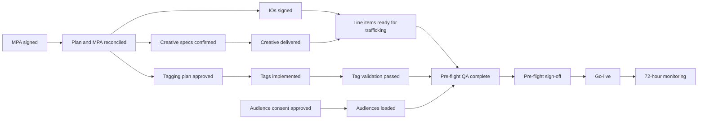

# Activation Dependency Diagram Template

- Campaign:
- Campaign slug:
- Date:
- Data status: Synthetic | Vendor input | Mixed

## Cross-track dependency diagram

## Critical path

| Dependency | Track | Owner | Due date | Status | Escalation trigger |
|---|---|---|---|---|---|
| MPA signed | Commercial |  |  |  |  |
| IO signed | Commercial |  |  |  |  |
| Creative specs confirmed | Shared |  |  |  |  |
| Creative delivered | Creative |  |  |  |  |
| Tag validation passed | Ad Ops |  |  |  |  |
| Audiences loaded | Ad Ops |  |  |  |  |
| Pre-flight QA complete | Shared |  |  |  |  |

## So what

## Decision needed

Request: `APPROVE PREFLIGHT`

## Assumptions and confidence

| Assumption | Confidence | Impact | Validation needed |
|---|---|---|---|
|  |  |  |  |
