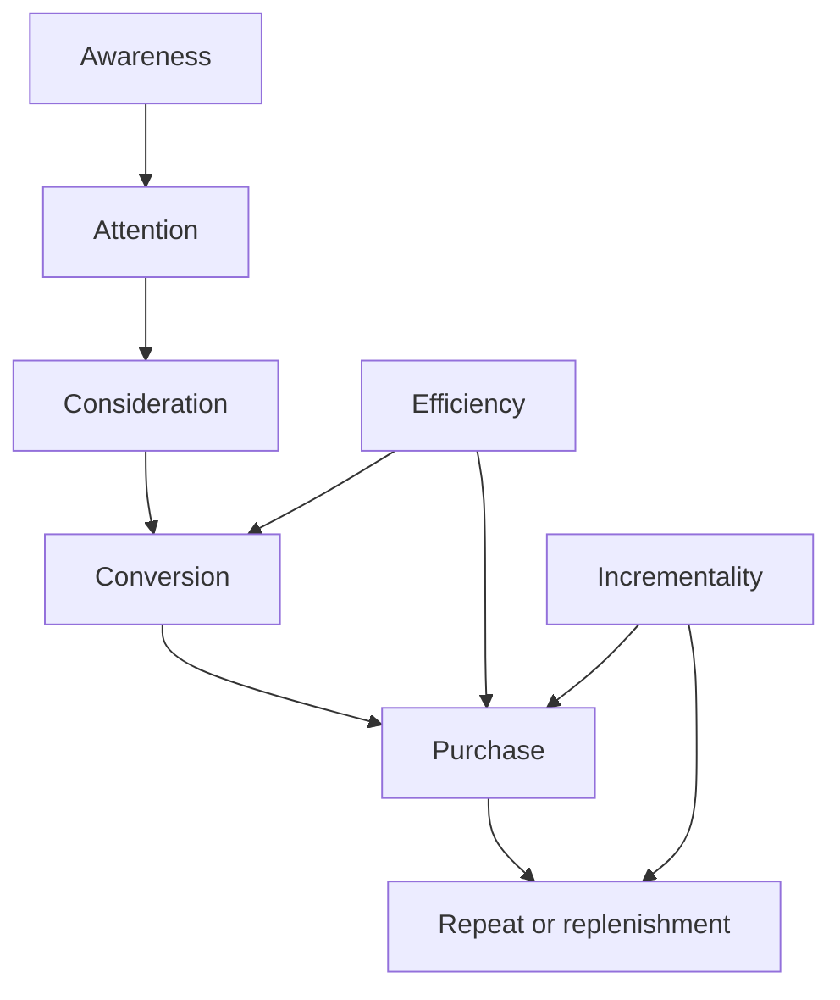

# KPI Tree Template

- Campaign:
- Campaign slug:
- Date:
- Data status: Synthetic | Supplied performance data | Mixed

## 1. Measurement objective

<Connect the KPI tree to the approved business, marketing, media, and measurement objectives.>

## 2. KPI tree

| Funnel stage | Business question | KPI | Definition | Target | Data source | Reporting cadence | Owner |
|---|---|---|---|---:|---|---|---|
| Awareness |  |  |  |  |  |  |  |
| Attention |  |  |  |  |  |  |  |
| Consideration |  |  |  |  |  |  |  |
| Conversion |  |  |  |  |  |  |  |
| Purchase |  |  |  |  |  |  |  |
| Repeat or replenishment |  |  |  |  |  |  |  |
| Efficiency |  |  |  |  |  |  |  |
| Incrementality |  |  |  |  |  |  |  |

## 3. KPI relationships

## 4. Reporting cuts

- Platform:
- Geography or market:
- Audience:
- Creative variant:
- Funnel stage:
- Retailer or channel:
- Time period:

## 5. Measurement limitations

| Limitation | KPI affected | Impact | Mitigation |
|---|---|---|---|
|  |  |  |  |

## So what

## Decision needed

Request: `APPROVE OPTIMIZATION`

## Assumptions and confidence

| Assumption | Confidence | Impact | Validation needed |
|---|---|---|---|
|  |  |  |  |
